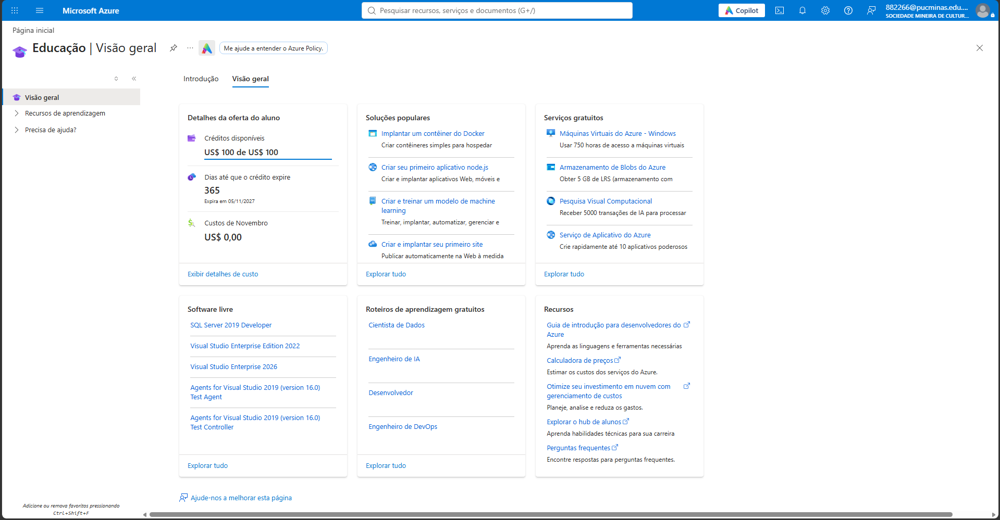
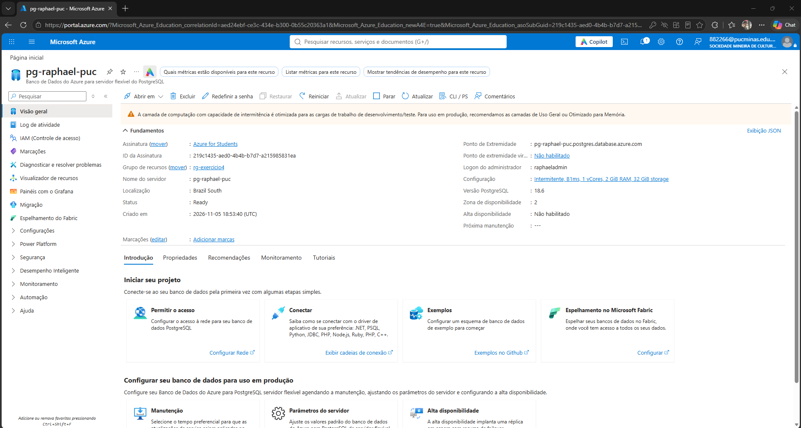
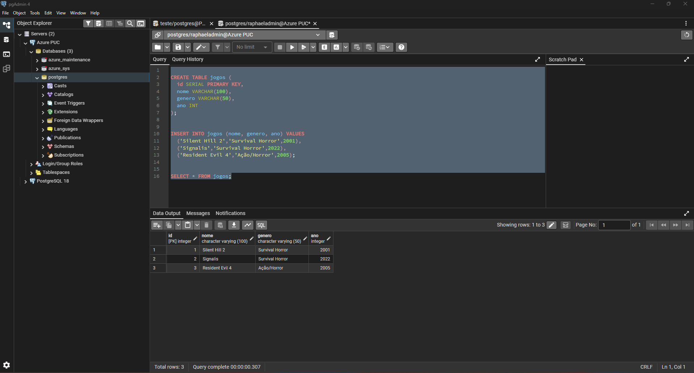
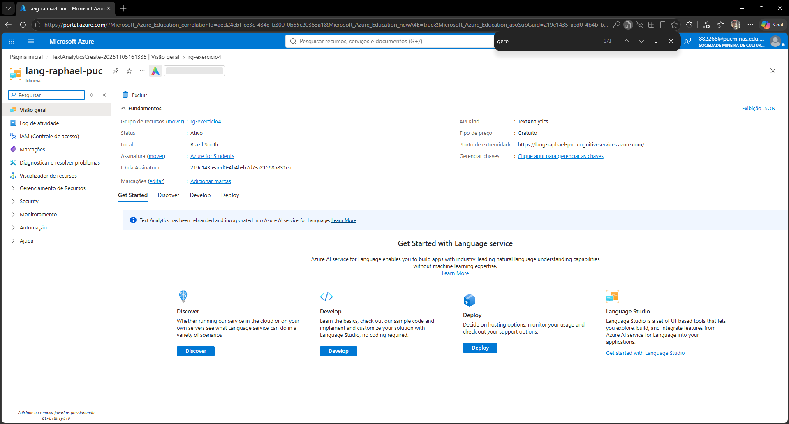

# Exercício 4 – Computação em Nuvem e Serviços Cognitivos (Microsoft Azure)

Atividade feita no Microsoft Azure com a assinatura **Azure for Students** (conta acadêmica PUC Minas).
Todos os recursos estão no grupo de recursos `rg-exercicio4`, região **Brazil South**.

| Produto | Recurso no Azure | Evidências |
|---|---|---|
| 1. Conta Azure | Assinatura Azure for Students (US$ 100 de crédito) | `produto1/portal-azure.png` |
| 2. Banco PostgreSQL | `pg-raphael-puc` – Azure Database for PostgreSQL (servidor flexível) | `produto2/recurso-postgres.png`, `produto2/select-resultado.png`, `produto2/script.sql` |
| 3. IA como serviço (opção b) | `lang-raphael-puc` – Azure AI Language (Idioma), tipo de preço Gratuito (F0) | `produto3/recurso-language.png`, `produto3/sentimento-java/` |

---

## Produto 1 – Conta no Azure

Conta ativada pelo programa **Azure for Students** com o e-mail acadêmico, sem cartão de crédito.
O print mostra o portal com o usuário vinculado (canto superior direito) e os créditos da oferta de aluno.



## Produto 2 – Banco PostgreSQL no Azure

- **Servidor:** `pg-raphael-puc.postgres.database.azure.com`
- **Configuração:** Intermitente (Burstable) B1ms, 1 vCore, 2 GiB RAM, 32 GiB, PostgreSQL 18
- **Acesso:** público com regra de firewall para o IP do cliente; conexão com SSL obrigatório
- **Cliente usado:** pgAdmin 4

Foi criada a tabela `jogos`, inseridos 3 registros e executado um `SELECT` (ver [`script.sql`](produto2/script.sql)).

**i) Recurso criado (nome do servidor e conta):**



**ii) Conexão ativa e resultado do SELECT:**



## Produto 3 – Serviço cognitivo pronto (opção b)

Foi escolhido o **Azure AI Language** (antigo Text Analytics / Cognitive Services) para fazer
**análise de sentimento** de textos em português. A aplicação Java envia textos para o serviço
na nuvem, que devolve o sentimento (positivo, negativo, neutro ou misto) com os níveis de confiança.

**i) Recurso criado no portal:**



**ii) Código Java:** [`produto3/sentimento-java`](produto3/sentimento-java)

```
sentimento-java/
├── pom.xml                                  ← dependência azure-ai-textanalytics
└── src/main/java/br/pucminas/AnaliseSentimento.java
```

### Como executar

Pré-requisitos: Java 17+ e Maven (ou VS Code com o *Extension Pack for Java*).

1. Defina as variáveis de ambiente com os dados de **Chaves e Ponto de Extremidade** do recurso
   (a chave **não** fica no código nem no repositório):

   ```powershell
   setx AZURE_LANGUAGE_KEY "<sua-chave>"
   setx AZURE_LANGUAGE_ENDPOINT "https://lang-raphael-puc.cognitiveservices.azure.com/"
   ```

   Feche e abra o terminal/VS Code depois do `setx`.

2. Rode o programa dentro de `produto3/sentimento-java`:

   ```bash
   mvn compile exec:java
   ```

   Para analisar um texto próprio:

   ```bash
   mvn compile exec:java -Dexec.args="'Hoje o dia está ótimo!'"
   ```

   Sem argumentos, o programa analisa um conjunto de frases de exemplo.

### Exemplo de saída


